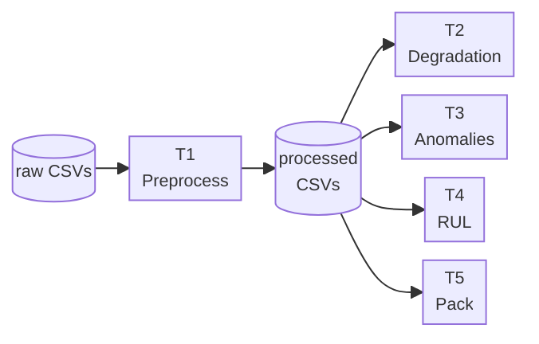
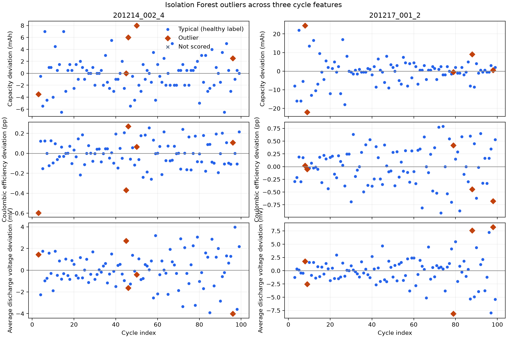
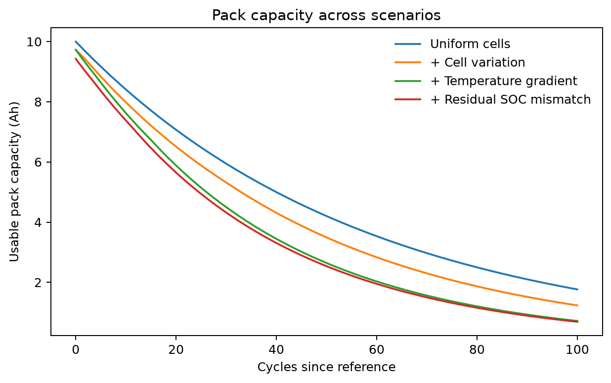
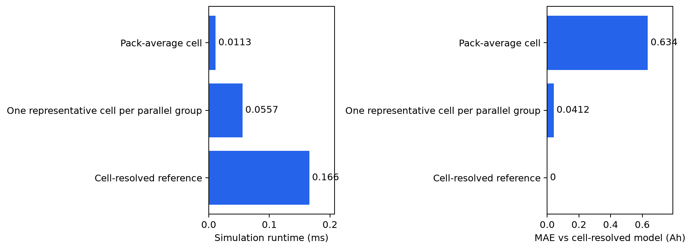

<div align="center">

<h1>Advanced Cell-Level Degradation Analysis &amp; Scaling</h1>

<p><em>Preprocessing · capacity fade · cycle anomalies · remaining useful life · module &amp; pack simulation</em></p>

<p>
  
  
  
  
</p>

<p>
  <a href="#setup"><b>Setup</b></a> ·
  <a href="#data"><b>Input data</b></a> ·
  <a href="#run"><b>Run the analysis</b></a> ·
  <a href="#visuals"><b>Visualizations</b></a> ·
  <a href="#references"><b>References</b></a>
</p>

</div>

---

This case study analyzes laboratory cycling data from **two LR1865SZ lithium-ion cell runs**. It covers preprocessing, capacity fade, cycle anomalies, remaining useful life (RUL), and an illustrative module and pack simulation.

## At a glance

<table>
  <tr>
    <th align="center"><sub>#</sub></th>
    <th align="left"><sub>Task</sub></th>
    <th align="left"><sub>Question</sub></th>
    <th align="left"><sub>Script</sub></th>
  </tr>
  <tr>
    <td align="center"><sub><b>1</b></sub></td>
    <td><sub><a href="#task-1">Preprocessing</a></sub></td>
    <td><sub>Is the raw data clean?</sub></td>
    <td><sub><code>preprocessing.py</code></sub></td>
  </tr>
  <tr>
    <td align="center"><sub><b>2</b></sub></td>
    <td><sub><a href="#task-2">Degradation modeling</a></sub></td>
    <td><sub>Which model forecasts fade best?</sub></td>
    <td><sub><code>degredation_analysis.py</code></sub></td>
  </tr>
  <tr>
    <td align="center"><sub><b>3</b></sub></td>
    <td><sub><a href="#task-3">Anomaly detection</a></sub></td>
    <td><sub>Which cycles are unusual?</sub></td>
    <td><sub><code>anomaly_detection.py</code></sub></td>
  </tr>
  <tr>
    <td align="center"><sub><b>4</b></sub></td>
    <td><sub><a href="#task-4">RUL estimation</a></sub></td>
    <td><sub>When does the cell reach end of life?</sub></td>
    <td><sub>4 scripts in <code>T4_rul_estimation/</code></sub></td>
  </tr>
  <tr>
    <td align="center"><sub><b>5</b></sub></td>
    <td><sub><a href="#task-5">Module &amp; pack scaling</a></sub></td>
    <td><sub>How does a cell scale to a pack?</sub></td>
    <td><sub><code>module_pack_scaling.py</code></sub></td>
  </tr>
</table>

<a id="setup"></a>
## Local setup

Use **Python 3.11** and run the commands from the **repository root**. Open that folder in VS Code if you want to run the notebooks.

<details open>
<summary><b>Windows PowerShell</b></summary>

```powershell
py -3.11 -m venv .venv
.\.venv\Scripts\python.exe -m pip install -r requirements.txt
.\.venv\Scripts\Activate.ps1
```

> [!TIP]
> If PowerShell blocks activation, use `.\.venv\Scripts\python.exe` in place of `python` in the commands below.

</details>

<details>
<summary><b>macOS or Linux</b></summary>

```bash
python3.11 -m venv .venv
source .venv/bin/activate
python -m pip install -r requirements.txt
```

</details>

**Verify the environment before running the models:**

```bash
python -m pip check
python -c "import numpy, pandas, scipy, sklearn, matplotlib, lmfit, torch"
```

> [!NOTE]
> **Notebooks:** install the VS Code *Python* and *Jupyter* extensions, open the notebook, select the `.venv` interpreter as its kernel, and run the cells in order.

<a id="data"></a>
## Input data

Place the original CSV exports supplied with the case study in `data/raw/` using these names:

| Run | Expected file name |
|-----|--------------------|
| Run 001 | `LR1865SZ_cycles201217_001_2.csv` |
| Run 002 | `LR1865SZ_cycles201214_002_4.csv` |

Task 1 expects these export headers:

<p>
  <code>Data_Point</code> · <code>Cycle_Index</code> · <code>Current(A)</code> · <code>Voltage(V)</code> ·
  <code>Capacity(Ah)</code> · <code>Energy(Wh)</code> · <code>Test_Time(s)</code> · <code>Date_Time</code>
</p>

> [!IMPORTANT]
> If the raw exports are absent from the checkout, obtain them from the case-study provider. If you already have both Task 1 processed CSVs, place them in `data/processed/` and start at Task 2.

<a id="run"></a>
## Run the analysis

Run **Task 1 first**. Tasks 2–5 read its outputs and can then run independently. The comparison plot in Task 4 uses recorded forecasts.



<a id="task-1"></a>
### Task 1 — Data engineering and preprocessing

```bash
python T1_data_engineering_preprocessing/preprocessing.py
```

Validates and cleans measurements, labels charge and discharge, and computes cycle duration, phase C-rates, coulombic efficiency, and energy throughput.

| Writes | Location |
|--------|----------|
| `measurements_clean.csv`, `cycle_summary.csv` | `data/processed/` |
| `coulombic_efficiency_trends.png` | root `results/` folder |

<a id="task-2"></a>
### Task 2 — Advanced degradation modeling

```bash
python T2_advanced_degredation_modeling/degredation_analysis.py
```

Reads both processed CSVs. Fits **linear, exponential, square-root time, and LSTM** models on cycles 2–80 and compares them on cycles 81–100. Computes dV/dQ for discharge cycles 2, 50, and 100. Prints held-out errors and saves the capacity forecast, dV/dQ, and model comparison plots under `T2_advanced_degredation_modeling/results/`.

<a id="task-3"></a>
### Task 3 — Anomaly detection

```bash
python T3_anomaly_detection/anomaly_detection.py
```

Reads `cycle_summary.csv` and screens for unusual deviations using a **capacity-only rule** and an **Isolation Forest**. Writes `anomaly_classification.csv` and `isolation_forest_cycle_classification.png` to `T3_anomaly_detection/results/`.

> [!NOTE]
> Open `T3_anomaly_detection/anomaly_detection.ipynb` for the **DBSCAN/PCA** analysis and run the deviation-cluster plot cell to export `deviation_clusters.png` to the path configured in the notebook.

<a id="task-4"></a>
### Task 4 — Remaining useful life estimation

```bash
python T4_rul_estimation/capacity_fade_extrapolation.py
python T4_rul_estimation/feature_based_ML_models.py
python T4_rul_estimation/sequence_models.py
python T4_rul_estimation/plot_rul_comparison.py
```

| Script | Inputs and outputs |
|--------|--------------------|
| `capacity_fade_extrapolation.py` | Uses the cycle summary to fit linear and exponential forecasts. Prints errors by early observation window and saves capacity-fade and RUL plots. |
| `feature_based_ML_models.py` | Uses both CSVs. Compares Ridge variants using capacity features, ΔQ variance, and charge duration in held-out runs. Prints EOL and RUL estimates and saves a RUL-by-cutoff plot. |
| `sequence_models.py` | Uses both CSVs. Trains LSTM and Transformer models and reports error and results across training seeds. Saves a model comparison and a RUL-by-cutoff plot. |
| `plot_rul_comparison.py` | Draws a cycle-6 comparison from recorded values in `RUNS`. Refresh those values after rerunning the models if you want the plot to reflect new results. |

All four write figures to `T4_rul_estimation/results/` by default.

> [!NOTE]
> **End-of-life reference.** The extrapolation script checks the 80% rated-capacity threshold. Since the runs were already below that threshold at cycle 2, the early-forecast comparison uses **80% of measured cycle-2 capacity** as the end-of-life reference.

<a id="task-5"></a>
### Task 5 — Module and pack scaling

```bash
python T5_module_pack_scaling/module_pack_scaling.py
```

Uses `cycle_summary.csv` to calibrate cell fade and simulate **four series-connected 8S4P modules**. Compares cell variation, temperature gradients, and residual state-of-charge mismatch, then benchmarks the runtime and agreement of three model resolutions. Prints the calibration, scenario, and benchmark tables and saves `pack_capacity_scenarios.png` and `scaling_accuracy_runtime.png` in `T5_module_pack_scaling/results/`.

<a id="visuals"></a>
## Required visualizations

| Deliverable | Default location or generator |
|-------------|-------------------------------|
| Capacity vs. cycle count with predictive curves | Task 2 capacity plot |
| Coulombic efficiency trends | Task 1 efficiency plot |
| Deviation clusters (anomalous cycles) | Task 3 anomaly notebook, deviation-cluster export cell |
| Forecasted RUL distributions | Capacity fade · Feature-based ML · Sequence models |

> [!NOTE]
> Generated figure links resolve once the corresponding PNGs are present in the checkout.

<details>
<summary><b>Figure gallery</b> (renders after the scripts have produced the PNGs)</summary>
<br>

<table>
  <tr>
    <td align="center" width="50%">
      <br>
      <sub><b>Task 1</b> · Coulombic efficiency trends</sub>
    </td>
    <td align="center" width="50%">
      <br>
      <sub><b>Task 3</b> · Isolation Forest cycle classification</sub>
    </td>
  </tr>
  <tr>
    <td align="center" width="50%">
      <br>
      <sub><b>Task 5</b> · Pack capacity scenarios</sub>
    </td>
    <td align="center" width="50%">
      <br>
      <sub><b>Task 5</b> · Scaling accuracy vs. runtime</sub>
    </td>
  </tr>
</table>

</details>

<a id="references"></a>
## References

1. *An Active Balancing Method Based on SOC and Capacitance for Lithium-Ion Batteries in Electric Vehicles.* **Frontiers in Energy Research** (2021), Table 1.
2. Weng, Siegel, and Stefanopoulou. *Differential voltage analysis for battery manufacturing process control.* **Frontiers in Energy Research** (2023).
3. *Novelty and Outlier Detection.* **scikit-learn** user guide.
4. Severson et al. [*Data-driven prediction of battery cycle life before capacity degradation.*](https://ui.adsabs.harvard.edu/abs/2019NatEn...4..383S/abstract) **Nature Energy** 4, 383–391 (2019).
5. Shamim et al. *Cell-level versus module-level degradation of Li-ion batteries for grid-scale storage: A four-year parallel aging experiment and empirical capacity-fade analysis.* **Journal of Power Sources** (2026).

---

<div align="center">
  <sub>Advanced Cell-Level Degradation Analysis &amp; Scaling · LR1865SZ case study</sub>
</div>